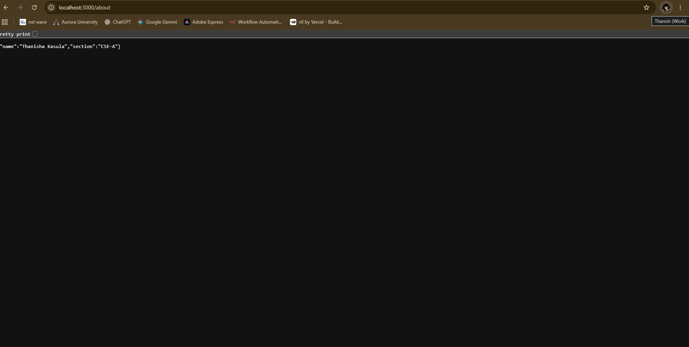
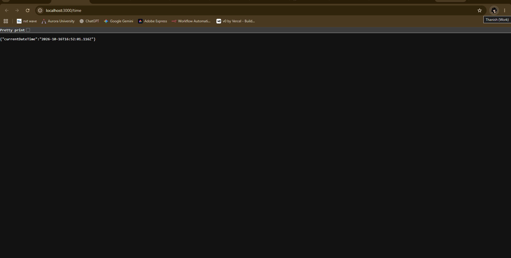
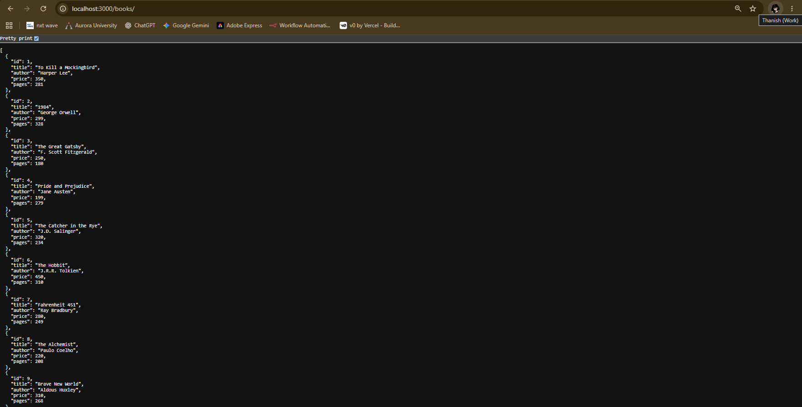
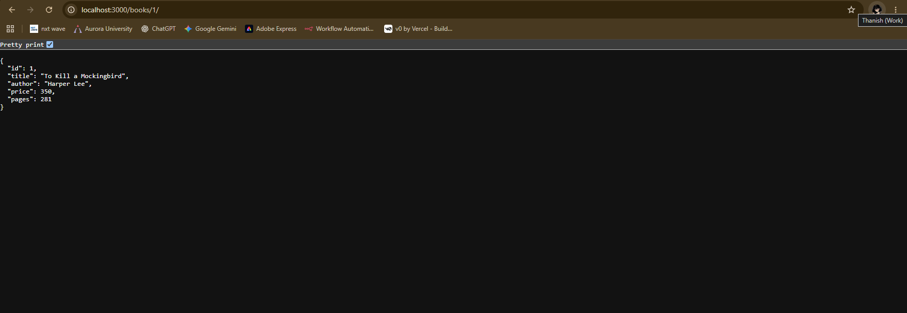
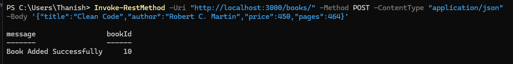
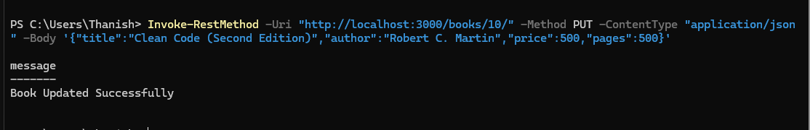
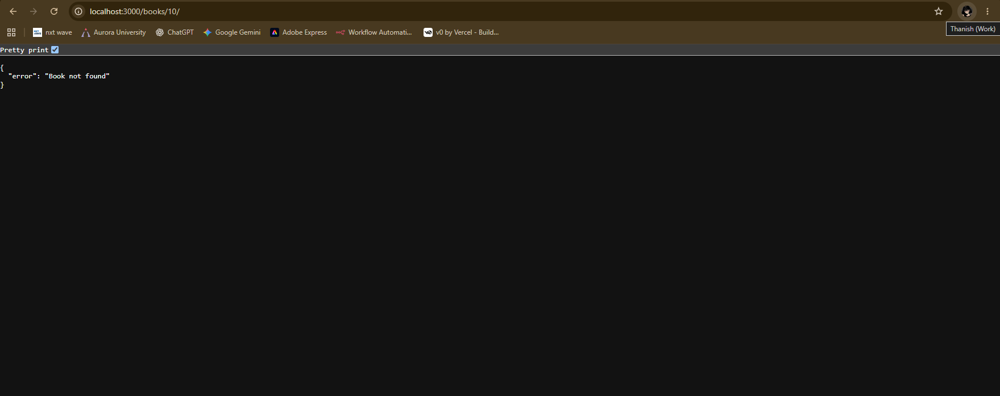
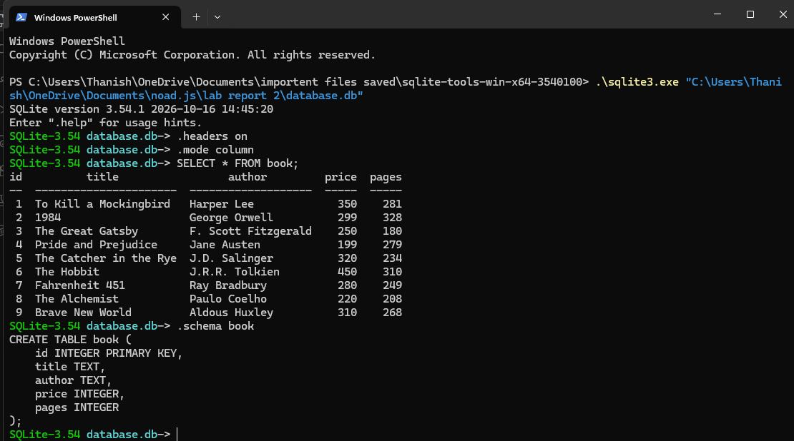

# Backend Development – Laboratory Reports

## Student Information

- **Name:** Kasula Thanish *(Note: Recorded as "Thanisha Kasula" in Lab 1 submission)*
- **Registration Number:** 252U1R9063
- **Section:** CSE-GEN-AI-2A
- **Course:** Backend Development Fundamentals
- **GitHub Repository:** [https://github.com/thanishkasula4-glitch/Backend-Development](https://github.com/thanishkasula4-glitch/Backend-Development)

---

## Laboratory Index

| Lab Number | Lab Title | Status |
|---|---|---|
| Lab 1 | Node.js and Express Server | Completed |
| Lab 2 | SQLite Database and CRUD Routes | Completed |
| Lab 3 | To be added | Pending |
| Lab 4 | To be added | Pending |
| Lab 5 | To be added | Pending |
| Lab 6 | To be added | Pending |
| Lab 7 | To be added | Pending |
| Lab 8 | To be added | Pending |
| Lab 9 | To be added | Pending |
| Lab 10 | To be added | Pending |

---

## Repository Structure

```text
Backend-Development/
├── README.md
├── .gitignore
├── lab-01/
│   ├── server.js
│   ├── server-http.js
│   ├── package.json
│   ├── package-lock.json
│   └── screenshots/
│       ├── home.png
│       ├── about.png
│       ├── time.png
│       └── 404.png
└── lab-02/
    ├── app.js
    ├── database.db
    ├── initDB.sql
    ├── package.json
    ├── package-lock.json
    └── screenshots/
        ├── database-verification.png
        ├── delete-book.png
        ├── get-all-books.png
        ├── get-book-by-id.png
        ├── post-add-book.png
        └── put-update-book.png
```

---

# Lab 1: Node.js and Express Server

## Student Details (Lab 1)

- **Name:** Thanisha Kasula
- **Registration Number:** 252U1R9063
- **Section:** CSE-GEN-AI 2A
- **Course:** Backend Development Fundamentals
- **Lab Number:** 01
- **Live Deployment URL:** [https://backend-development-utrs.onrender.com/](https://backend-development-utrs.onrender.com/)

## Objective

To set up a Node.js project, create a basic HTTP server using the built-in `http` module, and build an Express server with multiple routes and appropriate HTTP status codes.

## Technologies Used

- Node.js
- Express.js
- JavaScript
- npm
- Antigravity IDE

## Project Structure

```text
lab-01/
├── screenshots/
│   ├── home.png
│   ├── about.png
│   ├── time.png
│   └── 404.png
├── server-http.js
├── server.js
├── package.json
├── package-lock.json
└── (node_modules excluded via root .gitignore)
```

## Installation and Setup

### Prerequisites

- Node.js and npm installed
- Antigravity IDE, Visual Studio Code, or another code editor

### Steps to Run

1. Navigate to the `lab-01` folder in the terminal:

   ```bash
   cd lab-01
   ```

2. Install the dependencies:

   ```bash
   npm install
   ```

3. Start the Express server:

   ```bash
   node server.js
   ```

4. Open `http://localhost:3000` in your browser.

### Run the Basic HTTP Server

To run the server implemented using Node.js's built-in HTTP module:

```bash
node server-http.js
```

Stop the running server with `Ctrl + C` before starting another server that uses the same port.

## Endpoints

| Method | Endpoint | Description | Expected Status |
|---|---|---|---|
| GET | `/` | Returns a welcome message | 200 OK |
| GET | `/about` | Returns the student's name and section as JSON | 200 OK |
| GET | `/time` | Returns the current date and time as JSON | 200 OK |
| GET | `/unknown` | Demonstrates the response for an unknown route | 404 Not Found |

Other undefined paths will also return a 404 response.

## Screenshots

### 1. Home Route
Displays the welcome message.


### 2. About Route
Displays the student's name and section in JSON format.



### 3. Time Route
Displays the current date and time.



### 4. Unknown Route
Displays the 404 Page Not Found response.


## HTTP Status Codes

- **200 OK:** The request was successful.
- **404 Not Found:** The requested route does not exist.

## Viva Questions

### 1. What is the difference between `package.json` and `node_modules`?
`package.json` stores project metadata and dependency information. `node_modules` contains the installed packages required by the project.

### 2. What does `app.listen()` do?
`app.listen()` starts the Express server and makes it listen for incoming requests on a specified port.

### 3. What do `request` and `response` represent?
`request` contains information about the incoming HTTP request. `response` is used to send data and status codes back to the client.

### 4. What is the purpose of the `http` module in Node.js?
The built-in `http` module allows Node.js to create an HTTP server without requiring Express.

### 5. What is Express.js?
Express.js is a Node.js framework that simplifies handling HTTP requests, routes, and responses.

## Problems Faced and Solutions

- **Problem:** The server command was initially typed incorrectly.
- **Solution:** Used `node server.js` from the `lab-01` directory to start the Express server successfully.

## Git and Repository Notes

- The `.gitignore` file excludes `node_modules/` and `.env`.
- The `node_modules/` directory is not committed to GitHub.
- Screenshots are stored in the `lab-01/screenshots/` directory.

## Conclusion

Successfully created and tested a Node.js HTTP server and an Express server with home, about, time, and 404 routes.

---

# Lab 2: SQLite Database and CRUD Routes

## Student Details (Lab 2)

- **Name:** Kasula Thanish
- **Registration Number / Roll No.:** 252U1R9063
- **Section:** CSE-GEN-AI-2A
- **Course:** Backend Development Fundamentals
- **Lab Number:** 02

## Live Deployment Information

- **Live URL (GET /books/):** [https://lab-report-2-s043.onrender.com/books/](https://lab-report-2-s043.onrender.com/books/)
- **Base URL:** [https://lab-report-2-s043.onrender.com/](https://lab-report-2-s043.onrender.com/)
- **Hosting Platform:** Render (Web Service)
- **Deployment Status Note:** The service deployment URLs are preserved as configured. Build logs previously indicated a native SQLite binary error related to `GLIBC_2.38` on Linux during native module compilation; the service requires verification if this platform compatibility issue persists.

## Objective

To connect an Express web server to an SQLite database and build complete CRUD (Create, Read, Update, Delete) RESTful API routes with parameterized queries, proper HTTP status codes, and error handling.

## Technologies Used

- **Runtime:** Node.js
- **Server Framework:** Express (`express`)
- **Database:** SQLite (`sqlite`, `sqlite3`)
- **Development Tool:** Nodemon (`nodemon`)

## Project Structure

```text
lab-02/
├── app.js
├── database.db
├── initDB.sql
├── package.json
├── package-lock.json
└── screenshots/
    ├── database-verification.png
    ├── delete-book.png
    ├── get-all-books.png
    ├── get-book-by-id.png
    ├── post-add-book.png
    └── put-update-book.png
```

## Database Schema

The database consists of a `book` table in `database.db`:

```sql
CREATE TABLE IF NOT EXISTS book (
    id INTEGER PRIMARY KEY,
    title TEXT,
    author TEXT,
    price INTEGER,
    pages INTEGER
);
```

### Initial Sample Data (9 Records)

1. *To Kill a Mockingbird* by Harper Lee (Price: 350, Pages: 281)
2. *1984* by George Orwell (Price: 299, Pages: 328)
3. *The Great Gatsby* by F. Scott Fitzgerald (Price: 250, Pages: 180)
4. *Pride and Prejudice* by Jane Austen (Price: 199, Pages: 279)
5. *The Catcher in the Rye* by J.D. Salinger (Price: 320, Pages: 234)
6. *The Hobbit* by J.R.R. Tolkien (Price: 450, Pages: 310)
7. *Fahrenheit 451* by Ray Bradbury (Price: 280, Pages: 249)
8. *The Alchemist* by Paulo Coelho (Price: 220, Pages: 208)
9. *Brave New World* by Aldous Huxley (Price: 310, Pages: 268)

## Installation and Setup

### 1. Navigate to the Lab 2 Directory

```bash
cd lab-02
```

### 2. Install Dependencies

```bash
npm install
```

### 3. Running the Application

- **Development Mode (with auto-restart via nodemon):**
  ```bash
  npm run dev
  ```

- **Production / Standard Mode:**
  ```bash
  npm start
  ```

Once started, the server logs:
```text
Connected to the SQLite database successfully.
Server is running at http://localhost:3000/
```

## CRUD API Routes

| Method | Endpoint | Purpose | Request Body | Success Status | Error Status |
| :--- | :--- | :--- | :--- | :--- | :--- |
| **GET** | `/books/` | Get all books | None | `200 OK` | `500 Internal Server Error` |
| **GET** | `/books/:bookId/` | Get a book by ID | None | `200 OK` | `404 Not Found` / `500` |
| **POST** | `/books/` | Add a book | JSON object (`title`, `author`, `price`, `pages`) | `201 Created` | `400 Bad Request` / `500` |
| **PUT** | `/books/:bookId/` | Update a book | JSON object (`title`, `author`, `price`, `pages`) | `200 OK` | `400 Bad Request` / `404 Not Found` / `500` |
| **DELETE** | `/books/:bookId/` | Delete a book | None | `200 OK` | `404 Not Found` / `500` |

## HTTP Status Codes

- **200 OK:** Successfully retrieved, updated, or deleted a resource.
- **201 Created:** Successfully created a new book entry.
- **400 Bad Request:** Missing required fields in the request body.
- **404 Not Found:** Book with the requested ID does not exist.
- **500 Internal Server Error:** Unexpected database or server error.

## Screenshots

### 1. GET All Books (`GET /books/`)
Browser view fetching the complete list of 9 books from `http://localhost:3000/books/`.



### 2. GET Book by ID (`GET /books/:bookId/`)
Browser view fetching book ID 1 (*To Kill a Mockingbird*) from `http://localhost:3000/books/1/`.



### 3. POST Add Book (`POST /books/`)
Execution of the `POST /books/` request with payload `{ "title": "Clean Code", "author": "Robert C. Martin", "price": 450, "pages": 464 }`, returning `201 Created` with generated `bookId = 10`.



### 4. PUT Update Book (`PUT /books/:bookId/`)
Execution of the `PUT /books/10/` request updating the book to `{ "title": "Clean Code (Second Edition)", "author": "Robert C. Martin", "price": 499, "pages": 480 }`, returning `200 OK`.



### 5. DELETE Book (`DELETE /books/:bookId/`)
Execution of the `DELETE /books/10/` request, returning `200 OK` confirming the record deletion.



### 6. SQLite Database Verification
Terminal verification of `database.db` via the SQLite CLI showing table schema and current records using `SELECT * FROM book;`.



## SQLite CLI Commands for Verification

To verify the database directly via command-line interface:

1. **Open SQLite CLI Shell:**
   ```bash
   sqlite3 database.db
   ```
   *(Or using Python's built-in SQLite: `python -m sqlite3 database.db`)*

2. **Enable Readable Column Formatting:**
   ```sql
   .headers on
   .mode column
   ```

3. **View Table Schema:**
   ```sql
   .schema book
   ```

4. **Select All Books:**
   ```sql
   SELECT * FROM book;
   ```

5. **Verify Single Book:**
   ```sql
   SELECT * FROM book WHERE id = 1;
   ```

6. **Exit SQLite CLI:**
   ```sql
   .exit
   ```

## Problems Faced and Solutions

1. **Problem: Asynchronous Database Readiness vs. Server Launch**
   - *Challenge:* If `app.listen()` executes before SQLite finishes opening the database file, incoming HTTP requests result in runtime crashes (`TypeError: Cannot read properties of null (reading 'all')`).
   - *Solution:* Implemented `initializeDBAndServer()` using `async/await` where `app.listen()` is strictly placed inside the `try` block **after** `await open(...)` resolves successfully.

2. **Problem: Preventing SQL Injection Vulnerabilities**
   - *Challenge:* Directly concatenating strings or template literals (e.g. `WHERE id = ${bookId}`) allows malicious input to execute unauthorized SQL statements.
   - *Solution:* Used SQLite parameterized queries with `?` placeholders (`db.get('SELECT * FROM book WHERE id = ?;', [bookId])`) for every route receiving user input. The database engine automatically escapes and treats parameters as literal values.

3. **Problem: Accurate HTTP Status Codes for Edge Cases**
   - *Challenge:* Defaulting to `200 OK` for every response obscures missing resources, failed updates, or invalid client payloads.
   - *Solution:*
     - Returning `201 Created` for successful insertions (`POST`).
     - Returning `400 Bad Request` if required request body fields are missing.
     - Inspecting `dbResponse.changes === 0` to return `404 Not Found` for `PUT` and `DELETE` on non-existent IDs.
     - Returning `500 Internal Server Error` in all `catch` blocks.

## Conclusion

Successfully implemented and verified an Express server connected to an SQLite database with complete CRUD operations, parameterized SQL queries, appropriate HTTP status codes, and input validation.

---

## Future Laboratory Reports

### Lab 3: To be added
- **Status:** Pending

### Lab 4: To be added
- **Status:** Pending

### Lab 5: To be added
- **Status:** Pending

### Lab 6: To be added
- **Status:** Pending

### Lab 7: To be added
- **Status:** Pending

### Lab 8: To be added
- **Status:** Pending

### Lab 9: To be added
- **Status:** Pending

### Lab 10: To be added
- **Status:** Pending
