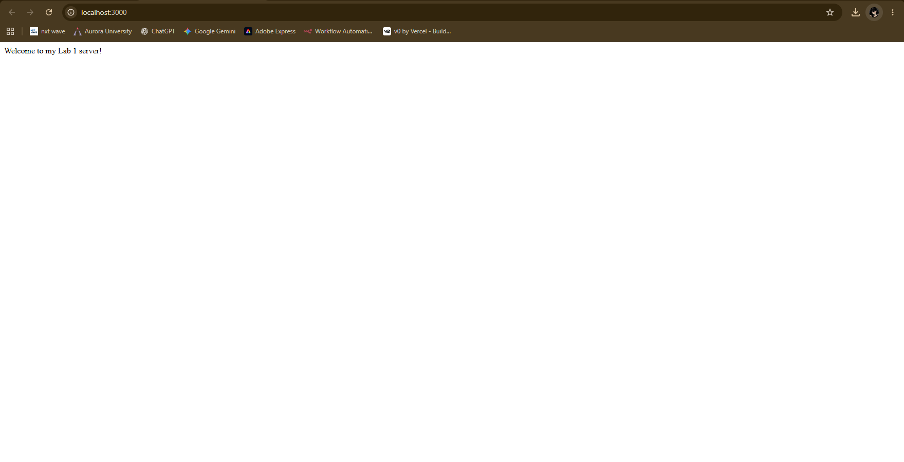
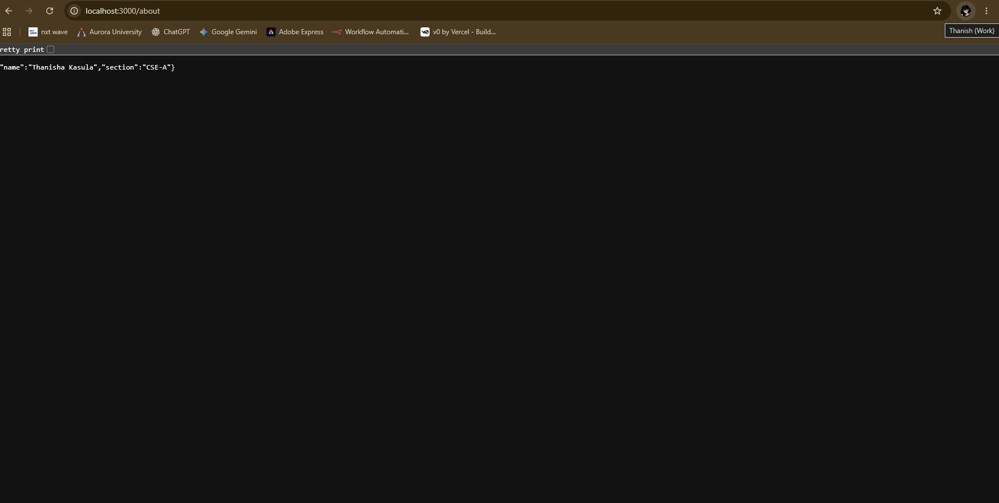
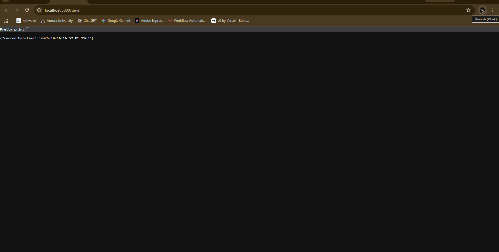
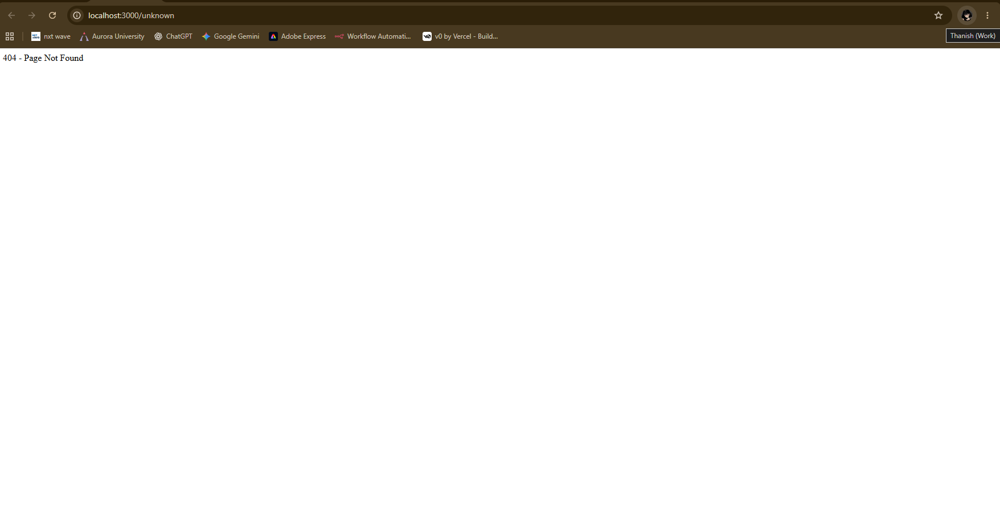

# Lab 1: Node.js and Express Server

## Student Details

- **Name:** Thanisha Kasula
- **Registration Number:** 252U1R9063
- **Section:** CSE-GEN-AI 2A
- **Course:** Backend Development Fundamentals
- **Lab Number:** 01

## Live Link

**Deployment URL:** Not deployed yet. The application is currently running locally at `http://localhost:3000`.

## Objective

To set up a Node.js project, create a basic HTTP server using the built-in `http` module, and build an Express server with multiple routes and appropriate HTTP status codes.

## Technologies Used

- Node.js
- Express.js
- JavaScript
- npm
- Antigravity IDE

## Project Structure

```text
lab-01/
├── screenshots/
│   ├── home.png
│   ├── about.png
│   ├── time.png
│   └── 404.png
├── server-http.js
├── server.js
├── package.json
├── package-lock.json
├── .gitignore
└── README.md
```

## Installation and Setup

### Prerequisites

- Node.js and npm installed
- Antigravity IDE, Visual Studio Code, or another code editor

### Steps to Run

1. Open the `lab-01` folder in the terminal.
2. Install the dependencies:

   ```bash
   npm install
   ```

3. Start the Express server:

   ```bash
   node server.js
   ```

4. Open `http://localhost:3000` in your browser.

### Run the Basic HTTP Server

To run the server implemented using Node.js's built-in HTTP module:

```bash
node server-http.js
```

Stop the running server with `Ctrl + C` before starting another server that uses the same port.

## Endpoints

| Method | Endpoint | Description | Expected Status |
|---|---|---|---|
| GET | `/` | Returns a welcome message | 200 OK |
| GET | `/about` | Returns the student's name and section as JSON | 200 OK |
| GET | `/time` | Returns the current date and time as JSON | 200 OK |
| GET | `/unknown` | Demonstrates the response for an unknown route | 404 Not Found |

Other undefined paths should also return a 404 response.

## Screenshots

### 1. Home Route

Displays the welcome message.



### 2. About Route

Displays the student's name and section in JSON format.



### 3. Time Route

Displays the current date and time.



### 4. Unknown Route

Displays the 404 Page Not Found response.



## HTTP Status Codes

- **200 OK:** The request was successful.
- **404 Not Found:** The requested route does not exist.

## Viva Questions

### 1. What is the difference between `package.json` and `node_modules`?

`package.json` stores project metadata and dependency information. `node_modules` contains the installed packages required by the project.

### 2. What does `app.listen()` do?

`app.listen()` starts the Express server and makes it listen for incoming requests on a specified port.

### 3. What do `request` and `response` represent?

`request` contains information about the incoming HTTP request. `response` is used to send data and status codes back to the client.

### 4. What is the purpose of the `http` module in Node.js?

The built-in `http` module allows Node.js to create an HTTP server without requiring Express.

### 5. What is Express.js?

Express.js is a Node.js framework that simplifies handling HTTP requests, routes, and responses.

## Problems Faced and Solutions

- **Problem:** The server command was initially typed incorrectly.
- **Solution:** Used `node server.js` from the `lab-01` project directory to start the Express server successfully.

## Git and Repository Notes

- The `.gitignore` file excludes `node_modules/` and `.env`.
- The `node_modules/` directory should not be committed to GitHub.
- Screenshots are stored in the `screenshots/` directory.
- The project will be submitted through the course GitHub repository.

## Conclusion

Successfully created and tested a Node.js HTTP server and an Express server with home, about, time, and 404 routes.