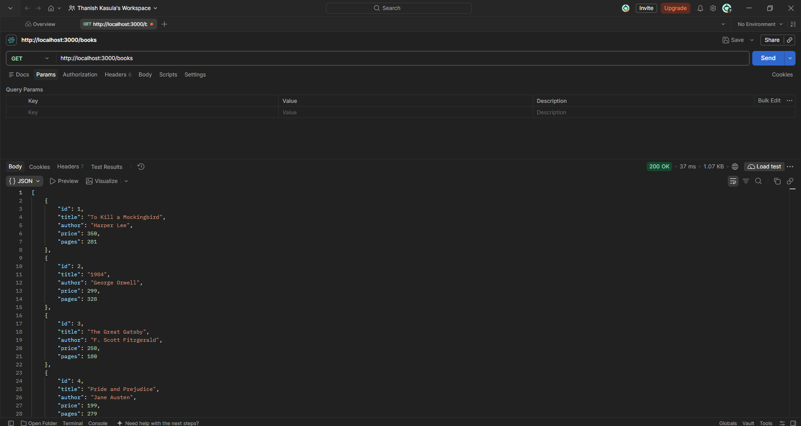
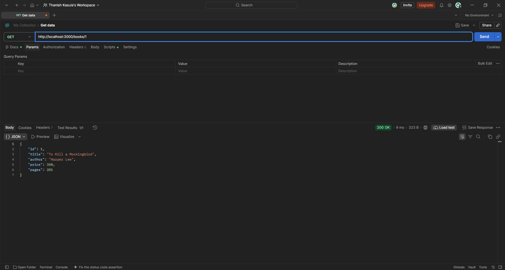

# Lab 3: REST API, Query Parameters, Validation and Debugging

## Student Information

- **Name:** Kasula Thanish
- **Registration Number / Roll No.:** 252U1R9063
- **Section:** CSE-GEN-AI-2A
- **Course:** Backend Development Fundamentals
- **Lab Number:** 03

---

## Objective

The objective of Lab 3 is to elevate the foundational SQLite and Express CRUD application developed in Lab 2 into a robust, secure, and production-ready **RESTful API**. Key competencies developed in this lab include:

1. Implementing **RESTful noun-based endpoint architecture**.
2. Supporting dynamic client-driven **filtering, searching, sorting, and pagination** using query parameters.
3. Performing partial text searches using **parameterized SQL `LIKE` queries** to prevent SQL injection.
4. Implementing strict **sorting whitelists** and **order direction validation**.
5. Applying server-side **request body validation** for data integrity and sanitization.
6. Adhering to **standard HTTP status codes** (`200 OK`, `201 Created`, `400 Bad Request`, `404 Not Found`, `500 Internal Server Error`).
7. Diagnosing and resolving common backend engineering pitfalls (**EADDRINUSE**, **table-name typos**, **wrong import paths**, and **missing `await` expressions**).

---

## Technologies Used

- **Runtime Environment:** Node.js (v18+)
- **Web Framework:** Express.js (`express` v5)
- **Database Engine:** SQLite3 (`sqlite3` v6)
- **Database Wrapper:** SQLite Promise Wrapper (`sqlite` v5)
- **Development Utility:** Nodemon (`nodemon` v3)
- **API Testing:** Postman & Node.js Automated Test Harness

---

## Project Structure

```text
lab-03/
├── app.js               # Main Express application with routes, validation, and error handling
├── database.db          # Embedded SQLite database holding the book table
├── initDB.sql           # SQL schema initialization and seed dataset
├── package.json         # Project metadata, dependencies, and npm scripts
├── package-lock.json    # Exact dependency tree lockfile
├── .gitignore           # Git ignore file excluding node_modules and sensitive configs
├── README.md            # Comprehensive project documentation and test evidence
└── screenshots/         # Directory containing Postman verification captures
    └── .gitkeep
```

---

## Installation and Setup

### 1. Prerequisites
- Node.js (version 18.x or later) installed on your system.
- npm (Node Package Manager) installed.
- Git installed.

### 2. Clone and Navigate
```bash
git clone https://github.com/thanishkasula4-glitch/Backend-Development.git
cd Backend-Development/lab-03
```

### 3. Install Dependencies
```bash
npm install
```
*(For production/Render environments requiring source compilation of SQLite native modules, use `npm install --build-from-source`)*

### 4. Database Initialization (Optional)
The pre-seeded SQLite database file `database.db` is included with the project. To recreate or reseed the database from scratch, run:
```bash
sqlite3 database.db < initDB.sql
```

---

## Environment Variables

| Variable | Type | Default | Description |
|---|---|---|---|
| `PORT` | Number | `3000` | The network port on which the Express server listens. In cloud deployment platforms (e.g., Render), this is injected automatically. |

*No secrets or sensitive API credentials are required for this project.*

---

## Starting the Application

### Production / Standard Mode:
```bash
npm start
```
*Executes `node app.js`.*

### Development Mode (with hot-reload):
```bash
npm run dev
```
*Executes `nodemon app.js`.*

When successfully started, the terminal displays:
```text
Connected to SQLite database successfully at: .../lab-03/database.db
Server is running at http://localhost:3000/
```

---

## RESTful API Endpoints

All endpoints use resource-oriented naming (`/books`) with HTTP methods conveying the desired action:

| Method | Endpoint | Description | Expected Status |
|---|---|---|---|
| `GET` | `/books` | Retrieve books with optional search, sorting, filtering, and pagination | `200 OK` / `400 Bad Request` |
| `GET` | `/books/:bookId` | Retrieve a single book record by ID | `200 OK` / `404 Not Found` |
| `POST` | `/books` | Create a new book record | `201 Created` / `400 Bad Request` |
| `PUT` | `/books/:bookId` | Update an existing book record by ID | `200 OK` / `400 Bad Request` / `404 Not Found` |
| `DELETE` | `/books/:bookId` | Remove a book record by ID | `200 OK` / `404 Not Found` |

---

## Query Parameter Documentation (`GET /books`)

The collection endpoint supports multiple composable query parameters:

### 1. Partial Title Search (`search_q`)
- **Query:** `search_q=<string>`
- **SQL Implementation:** `title LIKE ?` with parameter `'%<search_q>%'`.
- **Behavior:** Case-insensitive partial matching across book titles.
- **Example:** `GET /books?search_q=mocking`

### 2. Sorting (`order_by` and `order`)
- **Query:** `order_by=<column>&order=<direction>`
- **Allowed Columns (Whitelist):** `id`, `title`, `author`, `price`, `pages`.
- **Allowed Directions:** `ASC`, `DESC` (case-insensitive).
- **Default Values:** `order_by=id`, `order=ASC`.
- **Validation:** Unrecognized columns or invalid directions immediately return `400 Bad Request` with an explanatory message.
- **Example:** `GET /books?order_by=price&order=DESC`

### 3. Pagination (`limit` and `offset`)
- **Query:** `limit=<integer>&offset=<integer>`
- **Defaults:** `limit=10`, `offset=0`.
- **Validation:** `limit` must be a positive integer (`> 0`); `offset` must be a non-negative integer (`>= 0`).
- **Maximum Limit Cap:** Set to `100` to safeguard against denial-of-service query loads.
- **Example:** `GET /books?limit=5&offset=10`

### 4. Price-Range Filtering (`min_price` and `max_price`)
- **Query:** `min_price=<number>&max_price=<number>`
- **Validation:** Both values must be valid non-negative numbers. If both are supplied, `min_price` cannot exceed `max_price`.
- **Example:** `GET /books?min_price=200&max_price=350`

### 5. Combined Example
All query parameters work harmoniously in a single request:
```http
GET /books?search_q=the&order_by=price&order=DESC&min_price=200&max_price=500&limit=5&offset=0
```

---

## Request Body Validation (`POST /books` & `PUT /books/:bookId`)

Every modification request must supply a valid JSON body:

```json
{
  "title": "Clean Code",
  "author": "Robert C. Martin",
  "price": 450,
  "pages": 464
}
```

### Validation Rules:
1. **Title:** Must exist, be a string, and cannot be empty or whitespace only.
   - Error: `400 Bad Request` &rarr; `{"message": "Title is required"}`
2. **Author:** Must exist, be a string, and cannot be empty or whitespace only.
   - Error: `400 Bad Request` &rarr; `{"message": "Author is required"}`
3. **Price:** Must exist, must be of numeric type, and must be non-negative (`>= 0`).
   - Missing: `400 Bad Request` &rarr; `{"message": "Price is required"}`
   - Non-numeric: `400 Bad Request` &rarr; `{"message": "Price must be a valid number"}`
   - Negative: `400 Bad Request` &rarr; `{"message": "Price must be a positive number"}`
4. **Pages:** Optional, but if supplied must be a non-negative integer.

---

## HTTP Status Codes

| Code | Status | When Used |
|---|---|---|
| **200** | OK | Successful `GET` (collection or item), successful `PUT`, successful `DELETE`. |
| **201** | Created | Successful `POST` (returns new `bookId`). |
| **400** | Bad Request | Invalid JSON body, missing fields, invalid types, negative prices, invalid query parameters (bad column, invalid order, negative limit/offset, min_price > max_price). |
| **404** | Not Found | Requested `bookId` does not exist in the database, or the route endpoint is unknown. |
| **500** | Internal Server Error | Unhandled server exceptions or unexpected database connection failures. |

---

## Postman Testing Checklist

| # | Category | Request | Expected Status | Validation / Goal |
|---|---|---|---|---|
| 1 | GET | `GET /books` | `200 OK` | Fetch all books with default pagination (limit: 10, offset: 0). |
| 2 | GET | `GET /books?search_q=Mockingbird` | `200 OK` | Exact word partial title search. |
| 3 | GET | `GET /books?search_q=the` | `200 OK` | Partial substring search matching multiple records. |
| 4 | GET | `GET /books?order_by=price&order=ASC` | `200 OK` | Books sorted by price ascending. |
| 5 | GET | `GET /books?order_by=price&order=DESC` | `200 OK` | Books sorted by price descending. |
| 6 | GET | `GET /books?limit=3` | `200 OK` | Returns exactly 3 records. |
| 7 | GET | `GET /books?limit=2&offset=2` | `200 OK` | Skips first 2 records, returns records 3 and 4. |
| 8 | GET | `GET /books?min_price=350` | `200 OK` | Filters books with price &gt;= 350. |
| 9 | GET | `GET /books?max_price=250` | `200 OK` | Filters books with price &lt;= 250. |
| 10 | GET | `GET /books?min_price=250&max_price=350` | `200 OK` | Filters books within the price bracket [250, 350]. |
| 11 | GET | `GET /books?search_q=the&order_by=price&order=DESC&min_price=200&max_price=500&limit=5&offset=0` | `200 OK` | Combines search, sorting, price range, and pagination. |
| 12 | GET | `GET /books?order_by=invalid_column` | `400 Bad Request` | Rejects unwhitelisted column name. |
| 13 | GET | `GET /books?order=DIAGONAL` | `400 Bad Request` | Rejects unrecognized sort order direction. |
| 14 | GET | `GET /books?limit=-5` | `400 Bad Request` | Rejects non-positive integer limit. |
| 15 | GET | `GET /books?offset=-2` | `400 Bad Request` | Rejects negative offset. |
| 16 | GET | `GET /books?min_price=500&max_price=200` | `400 Bad Request` | Rejects inverted price range (min > max). |
| 17 | GET | `GET /invalid-endpoint` | `404 Not Found` | Returns consistent `Endpoint not found` JSON message. |
| 18 | GET | `GET /books/1` | `200 OK` | Fetches single book by ID. |
| 19 | GET | `GET /books/99999` | `404 Not Found` | Returns `Book not found` for nonexistent ID. |
| 20 | POST | `POST /books` (valid payload) | `201 Created` | Creates new book and returns `bookId`. |
| 21 | POST | `POST /books` (missing title) | `400 Bad Request` | Returns `Title is required`. |
| 22 | POST | `POST /books` (missing author) | `400 Bad Request` | Returns `Author is required`. |
| 23 | POST | `POST /books` (missing price) | `400 Bad Request` | Returns `Price is required`. |
| 24 | POST | `POST /books` (price: "abc") | `400 Bad Request` | Returns `Price must be a valid number`. |
| 25 | POST | `POST /books` (price: -50) | `400 Bad Request` | Returns `Price must be a positive number`. |
| 26 | PUT | `PUT /books/:id` (valid payload) | `200 OK` | Updates book record in SQLite. |
| 27 | PUT | `PUT /books/99999` | `404 Not Found` | Rejects updating nonexistent record. |
| 28 | DELETE | `DELETE /books/:id` | `200 OK` | Removes book from SQLite. |
| 29 | DELETE | `DELETE /books/99999` | `404 Not Found` | Rejects deleting nonexistent record. |

---

## Screenshots

Screenshots demonstrating API execution in Postman are saved in the `screenshots/` directory:

- **Get all books with query parameters:**
  
- **Get book by ID:**
  
- **POST add book with validation:**
  
- **PUT update book:**
  
- **DELETE book:**
  

*(Note: Screenshots are captured directly from Postman test executions and stored in [`screenshots/`](./screenshots/).)*

---

## Debugging Problems and Solutions

The following four critical backend engineering bugs were analyzed, diagnosed, and resolved during the implementation of Lab 3:

### 1. Port Conflict — `EADDRINUSE`
- **Cause:** Node.js throws `Error: listen EADDRINUSE: address already in use :::3000` when the application attempts to bind to a TCP port already held by another running process (such as another Node instance, background server, or container).
- **Diagnosis:** Run `netstat -ano | findstr :3000` (on Windows) or `lsof -i :3000` (on Linux/macOS) to identify the process ID (PID) holding the port.
- **Solution:** 
  1. Kill the conflicting process using `taskkill /PID <PID> /F` (Windows) or `kill -9 <PID>` (Unix).
  2. Implement dynamic port binding in `app.js` using `process.env.PORT || 3000` instead of a hardcoded integer. This allows cloud hosts (like Render) to allocate ephemeral ports dynamically without collisions.

### 2. Wrong Import Path
- **Cause:** Node.js uses CommonJS module resolution. Passing an incorrect relative path (e.g., `require("./database")` instead of `path.join(__dirname, "database.db")`, or `require("express.js")` instead of `require("express")`) throws `MODULE_NOT_FOUND` or fails silently at runtime.
- **Diagnosis:** Inspect module imports at the top of `app.js` and verify exact package names in `node_modules` and relative directory paths against the project root.
- **Solution:** Use explicit package identifiers (`require("express")`, `require("sqlite")`, `require("sqlite3")`) and construct absolute file paths using `path.join(__dirname, "database.db")` to eliminate working-directory dependency.

### 3. SQLite Table-Name Typo
- **Cause:** In SQLite, referencing a misspelled or pluralized table name (e.g., `SELECT * FROM books;` when the table was declared as `CREATE TABLE book`) results in a runtime SQL error: `SQLITE_ERROR: no such table: books`.
- **Diagnosis:** Inspect the database schema directly by inspecting `initDB.sql` or querying SQLite master table: `SELECT name, sql FROM sqlite_master WHERE type='table';`.
- **Solution:** Maintain consistent singular table naming (`book`) across every SQL statement (`SELECT ... FROM book`, `INSERT INTO book`, `UPDATE book`, `DELETE FROM book`).

### 4. Missing `await` in Asynchronous Database Calls
- **Cause:** In asynchronous SQLite libraries (`sqlite`), database operations (`open()`, `db.all()`, `db.get()`, `db.run()`) return Promises. Omitting the `await` keyword causes the variable to hold a pending Promise object rather than the resolved dataset. When serialized to JSON, the client receives `[object Promise]` or empty objects, and subsequent synchronous access attempts cause race conditions or unhandled rejections.
- **Diagnosis:** Notice routes returning `{}`, empty arrays, or finishing execution before database operations complete.
- **Solution:** Ensure every asynchronous database call is explicitly awaited inside an `async` function handler, and wrap operations in `try...catch` blocks to pass database errors to Express error-handling middleware.

---

## Render Deployment Preparation

Lab 3 is fully configured for deployment as an independent Web Service on Render:

- **Build Command:**
  ```bash
  npm install --build-from-source
  ```
  *(Compiling native C++ SQLite bindings from source prevents native ABI mismatches such as `GLIBC_2.38 not found`).*
- **Start Command:**
  ```bash
  node app.js
  ```
- **Port & Host Binding:**
  - Listens on `process.env.PORT || 3000`.
  - Explicitly binds to `0.0.0.0` for containerized host routing.
- **Database Persistence:**
  - Uses embedded SQLite `database.db` located via `path.join(__dirname, "database.db")`.
- **Deployment Isolation:**
  - Independent service running in its own subdirectory (`lab-03/`) without touching existing Lab 1 or Lab 2 deployments.

---

## Conclusion

Lab 3 successfully modernizes the book store backend into a complete, secure REST API. Through robust query parameter parsing, SQL parameterization, whitelist-enforced sorting, request body validation, and comprehensive error handling, the application satisfies production standards for API stability, security, and developer ergonomics.
